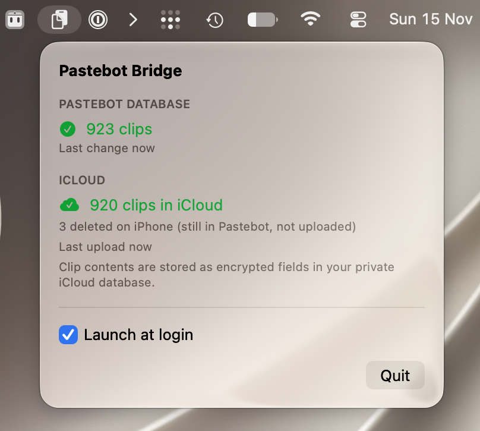
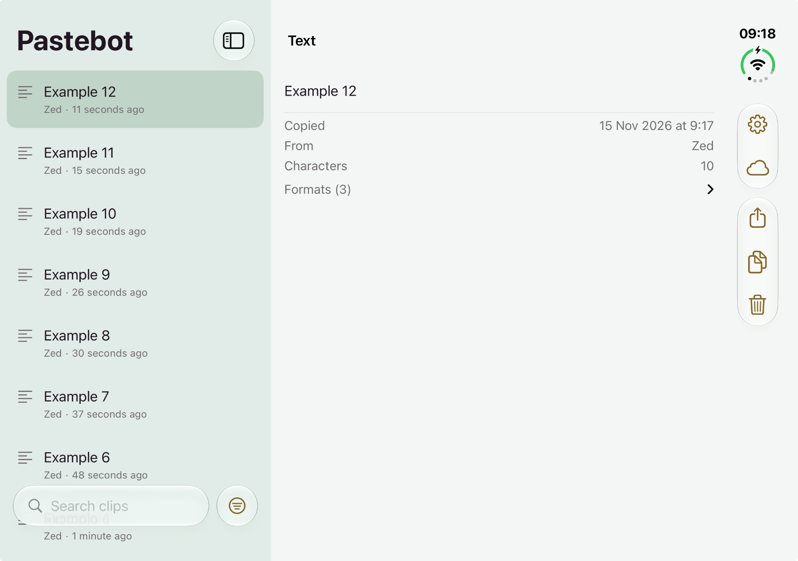

# Pastebot Bridge

Browse your Mac's [Pastebot](https://tapbots.com/pastebot/) or [Alfred](https://www.alfredapp.com/)
clipboard history on your iPhone and iPad.

A small macOS menu bar app reads the clipboard manager's local database and mirrors every clip into
your **private iCloud database**. A companion iOS app syncs that history onto the device so you can
search, view and copy clips anywhere, even offline.

<p align="center">
  
</p>



> Not affiliated with Tapbots or Running with Crayons. Pastebot and Alfred are trademarks of their
> respective owners.

## Features

- **Pastebot and Alfred support.** Mirrors either clipboard manager, or both at once, and shows
  which one each clip came from.
- **Read-only on the Mac.** The bridge never writes to Pastebot's or Alfred's database.
- **Private by design.** Clips live in your own private CloudKit database. Text, source app, dates
  and types are stored as encrypted fields; with Advanced Data Protection they're end-to-end
  encrypted. No servers or accounts of its own.
- **Live sync.** The Mac uploads changes as they happen; CloudKit pushes wake the iOS app to sync in
  the background.
- **Works offline.** The full history, including images, is kept on the device.
- **Text and images.** Full-size image viewer with zoom, plus every pasteboard format a clip carries.
- **Search, copy, share and delete** from iPhone or iPad. Deleting on iOS removes the clip from
  iCloud but leaves it in Pastebot/Alfred on the Mac.
- **Menu bar status** showing clip counts, iCloud state, and a warning when something needs
  attention (such as missing Full Disk Access), plus a Launch at login toggle.

## Requirements

- A Mac running macOS 14 or later with [Pastebot](https://tapbots.com/pastebot/) 3 and/or
  [Alfred](https://www.alfredapp.com/) (Powerpack, with Features › Clipboard History turned on).
- An iPhone or iPad on iOS 26 or later, signed in to the **same iCloud account** as the Mac.
- To build: Xcode 26 or later, [XcodeGen](https://github.com/yonaskolb/XcodeGen)
  (`brew install xcodegen`), and an Apple Developer account (CloudKit needs a paid membership). The
  scripts use `/Applications/Xcode.app` unless `DEVELOPER_DIR` is set.

## Setup

### 1. Configure signing and iCloud

Copy `Config/Local.xcconfig.example` to `Config/Local.xcconfig` (gitignored) and set your team ID:

```
DEVELOPMENT_TEAM = ABCDE12345
```

The bundle IDs (`dev.pastebotbridge.*`) and the iCloud container (`iCloud.dev.pastebotbridge`) are
registered to the original developer's team, so change them to your own:

- `bundleIdPrefix` and both `PRODUCT_BUNDLE_IDENTIFIER`s in `project.yml`;
- the iCloud container in `project.yml` (both targets) and `containerID` in `Shared/CloudSchema.swift`.

Then run `xcodegen generate` (the scripts also do this), which regenerates the project and the
entitlements files.

A new container has no schema, and both apps use the **Production** CloudKit environment (see
[How sync works](#how-sync-works)), so create it once: temporarily set
`com.apple.developer.icloud-container-environment` to `Development` for both targets, run the Mac app
until it has uploaded clips, delete one clip on the iPhone (this creates the `Clip` and `DeletedClip`
record types), deploy the schema to Production in the CloudKit Console, and switch the entitlement
back.

### 2. Mac

```sh
./scripts/install-mac.sh
```

This builds the Release configuration, installs it to `~/Applications/Pastebot Bridge.app`
(replacing and quitting any running copy) and launches it. On a build failure it prints the errors
and leaves the full log in `build/install-mac.log`.

Then add the app under System Settings › Privacy & Security › **Full Disk Access**. The menu bar
window has a button that opens this pane, and it connects automatically once access is granted. If
it asks again after a reinstall, remove the app from that list and add it back.

Launch it normally (Finder, `open`, or at login). Running the binary directly from a terminal makes
CloudKit fail with "Not Authenticated".

### 3. iPhone / iPad

```sh
open PastebotBridge.xcodeproj
```

Select the **PasteViewer** scheme and your device, then Run (the device needs Developer Mode on).
For a build that installs without Xcode, use [TestFlight](#testflight).

## How sync works

- **Mac → iCloud:** on every Pastebot or Alfred database change, `CloudUploader` diffs their entries
  (id + version) against what it has uploaded and queues saves and deletes on a `CKSyncEngine`. A
  database that can't be read is skipped rather than treated as empty, so its clips stay in iCloud.
  Each entry is one `Clip` record in the `Clips` zone; images and very long text are `CKAsset`s.
- **iCloud → iPhone:** `CloudSync` runs a `CKSyncEngine`, applies fetched changes to `ClipsModel`,
  and persists them under Application Support (`OfflineClips`, excluded from backup).
- **Deleting on iPhone:** the app deletes the `Clip` record and saves a `DeletedClip` tombstone. The
  Mac never re-uploads that clip while it is still in Pastebot/Alfred (the menu bar window shows how
  many are excluded); once it's gone from there too, the Mac removes the tombstone.

Both apps use the CloudKit **production** environment
(`com.apple.developer.icloud-container-environment = Production`), including builds run from Xcode,
so TestFlight and Xcode builds share the same data. Schema changes (new record types or fields) must
be made in Development and deployed to Production in the CloudKit Console before production clients
can write them.

## Where the clipboard managers keep their data

Pastebot:

```
~/Library/Containers/com.tapbots.Pastebot3Mac/Data/Documents/general.pastebot/sql   (SQLite, WAL)
  entries(uuid, version, created_at unix-seconds, source_name, source_bundle_identifier, …)
  types_data(entry_uuid, item_index, type UTI, data BLOB)
```

(`Library/Application Support/Pastebot/log.sql` is only Pastebot's diagnostic log.)

Alfred:

```
~/Library/Application Support/Alfred/Databases/clipboard.alfdb   (SQLite)
  clipboard(item, ts seconds-since-2001, app, apppath, dataType, dataHash)
    dataType 0 text (in item) · 1 image · 2 file list
~/Library/Application Support/Alfred/Databases/clipboard.alfdb.data/<dataHash>
    image rows: TIFF · file rows: plist array of paths
```

Alfred's table has no stable key, so the bridge derives each clip's id from its type, timestamp and
content (`alfred-<hash>`). Alfred only keeps text, images and files, never edits an entry, and
expires entries after the period set in its preferences (these are then deleted from iCloud too).

## Distribution

### Mac release (Developer ID)

```sh
./scripts/release-mac.sh 1.0
```

Archives, signs with your Developer ID certificate, notarizes and staples the app, then packages,
signs, notarizes and staples `build/release/PastebotBridge-<version>.dmg`. The version defaults to
`MARKETING_VERSION` in `project.yml`; the build number is a timestamp. The app is notarized through
the Apple account signed in to Xcode, and the DMG through the notarytool keychain profile named by
`NOTARY_PROFILE` (default `pastebot-bridge-notary`), created once with:

```sh
xcrun notarytool store-credentials pastebot-bridge-notary --apple-id <apple id> --team-id <team id>
```

Set `IDENTITY` to choose a specific signing certificate. Logs for each step are in `build/release/`.

### TestFlight

1. CloudKit Console › your container › **Deploy Schema Changes** to Production.
2. App Store Connect › Apps › **+** › New App: iOS, your viewer bundle ID, a unique name, any SKU.
3. `./scripts/upload-testflight.sh` archives with a timestamp build number and uploads for internal
   testing only (no App Review), using the Apple account signed in to Xcode. Logs are in
   `build/testflight/`.
4. App Store Connect › the app › TestFlight: add yourself to an internal group and install through
   the TestFlight app. Builds expire after 90 days.

### Signing troubleshooting

If `security find-identity -v -p codesigning` reports 0 valid identities even though Xcode shows the
certificate, install Apple's WWDR G3 intermediate (`AppleWWDRCAG3.cer`) from
https://www.apple.com/certificateauthority/.

## Icons

Original artwork drawn by `scripts/render-icons.swift` (no SF Symbols or Pastebot branding),
including the iOS dark-appearance variant. Regenerate from the repo root with
`swift scripts/render-icons.swift`; the script's header explains how to rebuild the smaller Mac sizes.
